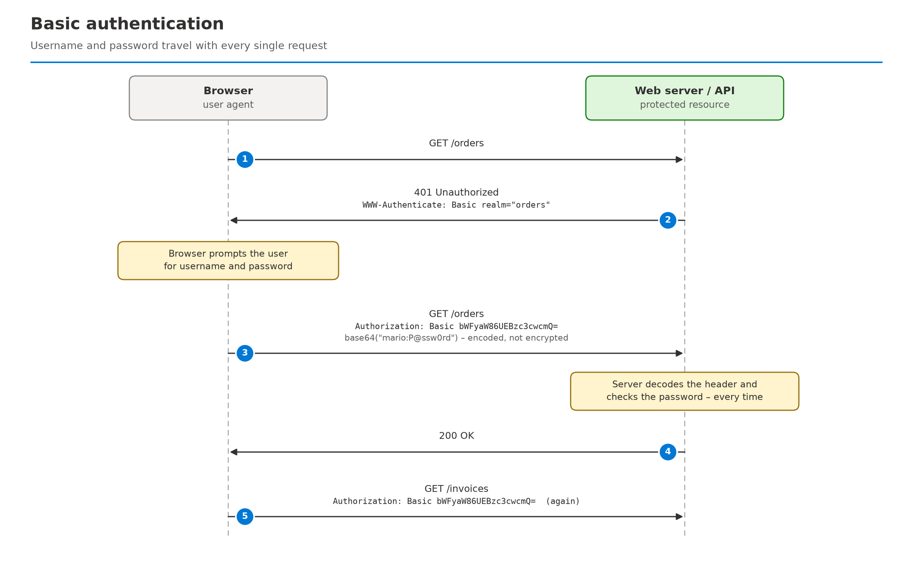
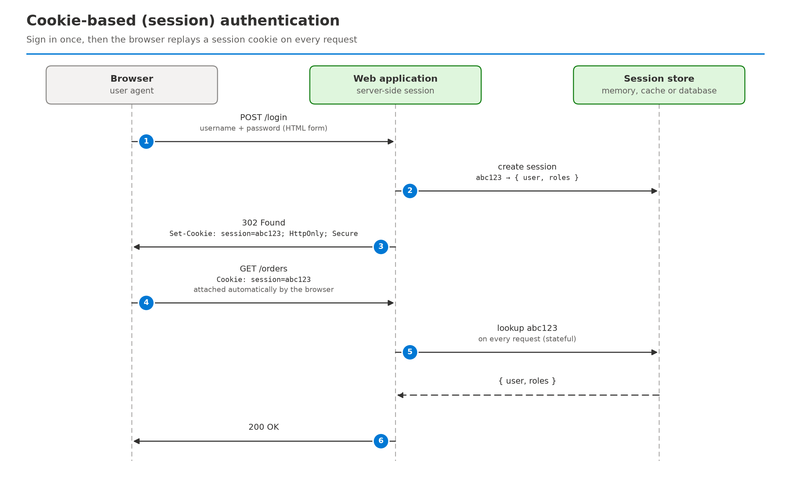
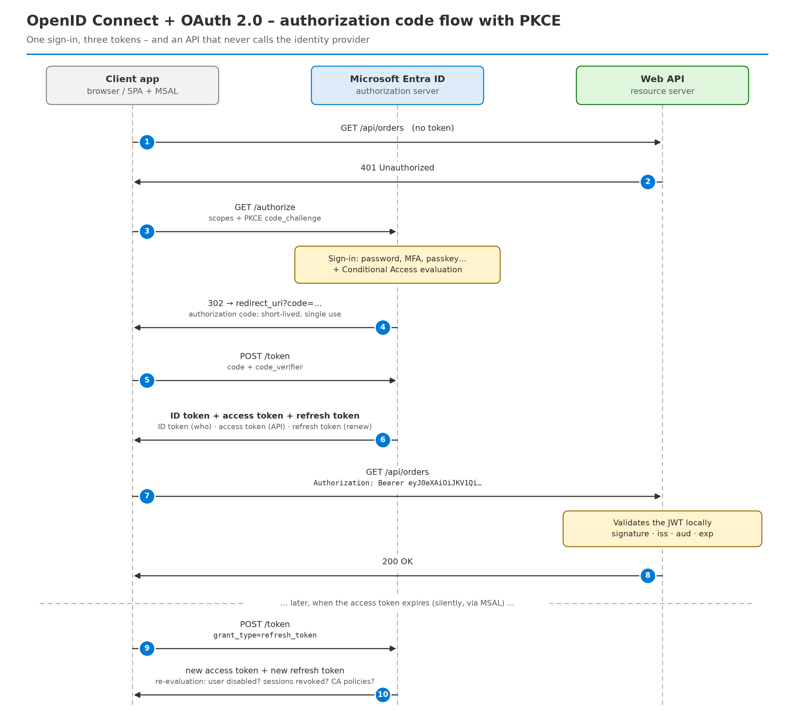
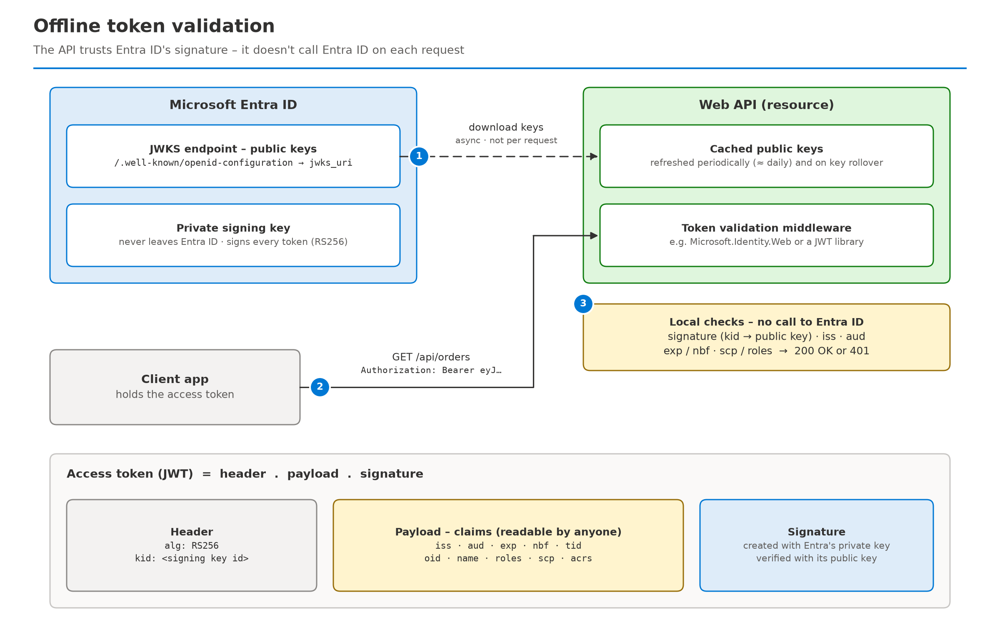
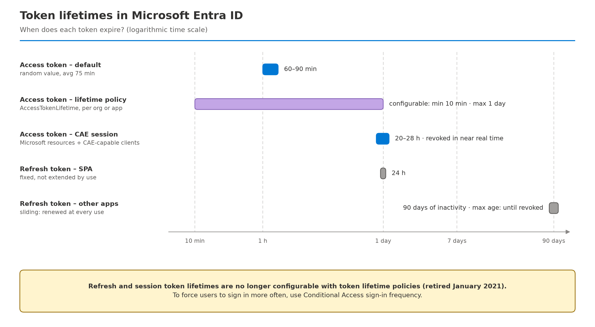
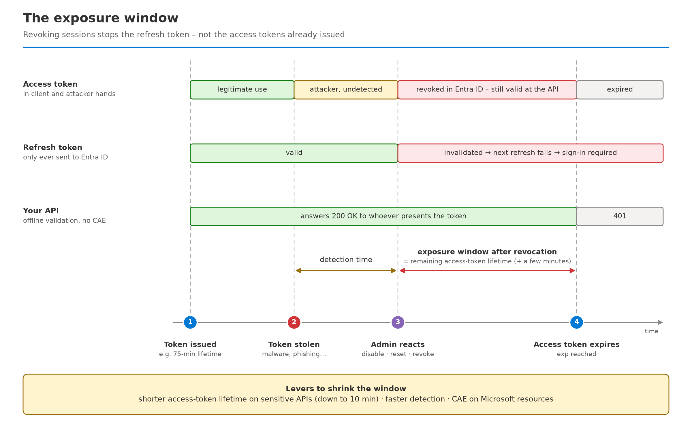
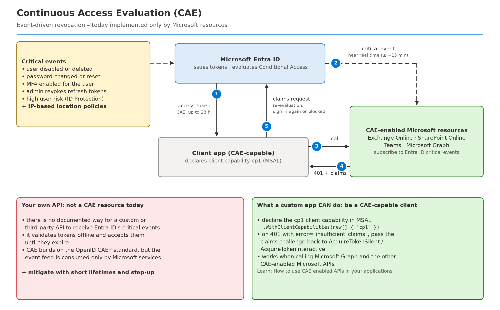
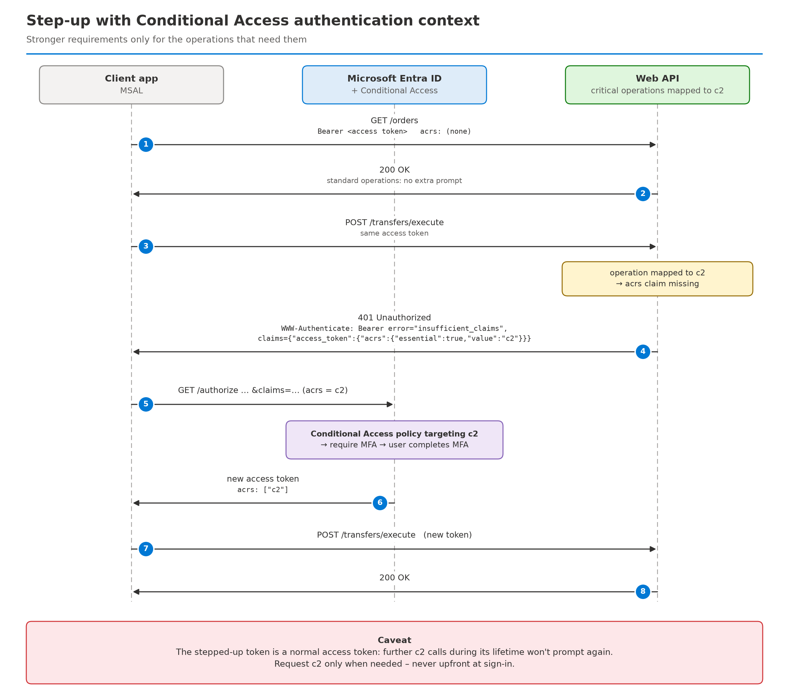
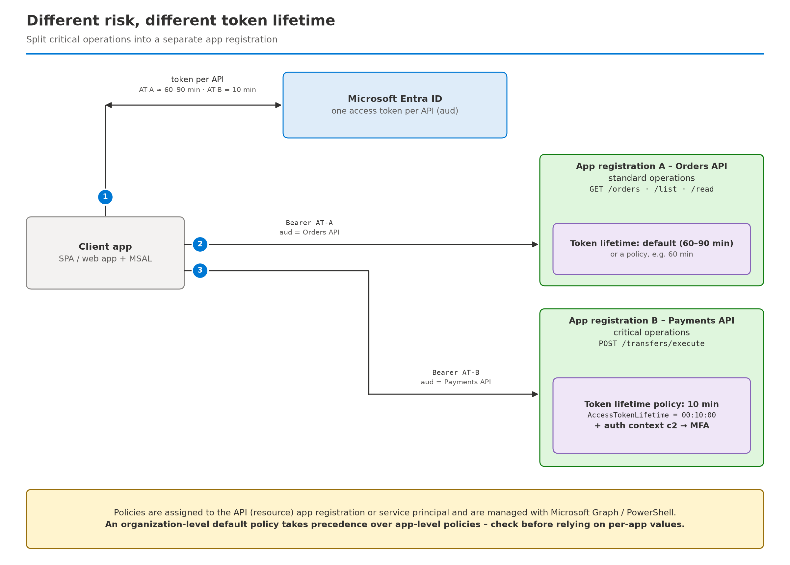
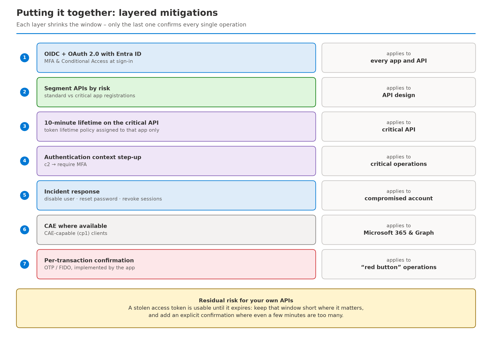

Sooner or later, every team building an application hears this question from security: *"If a user's token is stolen, how fast can we kill it?"* The answer depends on how authentication works and on which parts of the token lifecycle the identity provider controls.

This post walks from Basic authentication to cookies to OpenID Connect and OAuth 2.0, then focuses on Microsoft Entra ID: token lifetimes, what revocation really does, and where Continuous Access Evaluation (CAE), Conditional Access and authentication context help—and where they stop.

**A note on scope:** this isn't a complete guide to the protocols involved, their variants, exceptions or RFCs. Each section covers only what you need to understand the access-token problem and how Entra ID helps contain it. 

## 1. Basic authentication

Basic authentication is HTTP's simplest scheme. The server answers an unauthenticated request with `401 Unauthorized` and a `WWW-Authenticate: Basic` header; the browser asks the user for a username and password and, from then on, sends them with **every** request in the `Authorization` header, merely base64-encoded.



<p style="text-align: center"><em>download the <a href="/assets/post/2026/entra-token/01-basic-auth.drawio">draw.io source file</a></em></p>

**Pros:** it's trivial to implement, needs no state on the server and is understood by every HTTP client and library.

**Cons:** base64 is an encoding, not encryption, so the password travels with every call and TLS is mandatory. There's no real logout, no expiry and no way to revoke access short of changing the password. MFA and Conditional Access can't be enforced, and every application sees the user's actual password.

**When:** it dates back to the first HTTP specifications in the mid-1990s and was everywhere in the late '90s and 2000s: intranets, early web services, mail protocols. Today it's considered legacy: Microsoft has turned it off in Exchange Online, and its own analysis attributes more than 97% of credential-stuffing attacks to legacy authentication.

#### For more information

- [Deprecation of Basic authentication in Exchange Online](https://learn.microsoft.com/en-us/exchange/clients-and-mobile-in-exchange-online/deprecation-of-basic-authentication-exchange-online)
- [Block legacy authentication with Conditional Access](https://learn.microsoft.com/en-us/entra/identity/conditional-access/policy-block-legacy-authentication)

## 2. Cookie-based authentication

Cookie (or session) authentication fixed the "password on every request" problem. The user signs in once through an HTML form; the server validates the credentials, creates a session (an identifier mapped to the user in a server-side store, or an encrypted ticket) and returns it in a `Set-Cookie` header. The browser then attaches the cookie automatically to every request to that site.



<p style="text-align: center"><em>download the <a href="/assets/post/2026/entra-token/02-cookie-auth.drawio">draw.io source file</a></em></p>

**Pros:** the password is sent only once, the server can end a session whenever it wants, and the `HttpOnly`, `Secure` and `SameSite` flags harden the cookie against script access and cross-site abuse.

**Cons:** server-side sessions are stateful (you need a shared session store to scale out), cookies are bound to the browser and to a single site, and CSRF protection is required (Cross-Site Request Forgery: another site tricks the browser into sending a request, cookie included, on the user's behalf). Above all, whoever steals the cookie *is* the user until the session ends. And once issued, the app's cookie is the single source of identity: if the account is disabled in the directory, the app keeps honouring it unless it re-validates the session on each request.

**When:** cookies arrived with Netscape in 1994 and were the dominant way to secure web applications through the 2000s and early 2010s—think forms authentication, or federation protocols such as WS-Federation and SAML, where the identity provider's response becomes an app session cookie.

Is a cookie safer than a bearer token? Not intrinsically. Both are bearer artifacts sent over TLS: malware in the browser can steal either, and whoever holds one will never sign out. What OAuth 2.0 adds is a **separation of duties**: a long-lived credential (the refresh token) that is only ever sent to the identity provider, and a short-lived one (the access token) sent to APIs.

#### For more information

- [Use cookie authentication without ASP.NET Core Identity](https://learn.microsoft.com/en-us/aspnet/core/security/authentication/cookie) – see "React to back-end changes"
- [Revoke user access in Microsoft Entra ID](https://learn.microsoft.com/en-us/entra/identity/users/users-revoke-access) – see "Session tokens (cookies)"

## 3. OpenID Connect and OAuth 2.0

OAuth 2.0 (2012) is an authorization framework; OpenID Connect (2014) adds an identity layer on top of it. With Microsoft Entra ID, the recommended pattern for apps that sign in users is the authorization code flow with PKCE:



<p style="text-align: center"><em>download the <a href="/assets/post/2026/entra-token/03-oidc-oauth2-flow.drawio">draw.io source file</a></em></p>

1. The client calls the API without a token and gets a `401`.
2. The client redirects the user to Entra ID's `/authorize` endpoint. The user signs in—password, MFA, passkey—and Conditional Access policies are evaluated.
3. Entra ID returns a short-lived, single-use **authorization code**.
4. The client redeems the code at the `/token` endpoint and receives, in a single response:
   - an **ID token**, which tells the client *who* the user is;
   - an **access token**, a signed JWT that authorizes calls to *one* API (its `aud` claim), sent as `Authorization: Bearer`;
   - a **refresh token**, a long-lived, opaque credential that is only ever sent back to Entra ID to get new tokens.
5. When the access token expires, the authentication library (MSAL) silently redeems the refresh token. This is the moment Entra ID re-evaluates the user: a disabled account, revoked sessions or new Conditional Access requirements are enforced here.

### Offline validation: the key design choice

The API never calls Entra ID to check a token. At startup, and then periodically (roughly daily), its middleware downloads Entra ID's public signing keys from the `jwks_uri` in the OpenID configuration document. It then validates each JWT locally: signature (using the key identified by the `kid` header), issuer, audience, expiry, scopes or roles.



<p style="text-align: center"><em>download the <a href="/assets/post/2026/entra-token/04-offline-validation.drawio">draw.io source file</a></em></p>

**Advantages:** no round trip to the identity provider per request, so validation is fast, scales horizontally and survives identity-provider hiccups; the API stays stateless.

**Disadvantages:** Entra ID can't "recall" a token it has already issued. A correctly signed, unexpired access token is valid, even if the user was just disabled or the token is in an attacker's hands. Revocation only takes effect when the client goes back to Entra ID—that is, at the next refresh.

#### For more information

- [Microsoft identity platform and OAuth 2.0 authorization code flow](https://learn.microsoft.com/en-us/entra/identity-platform/v2-oauth2-auth-code-flow)
- [OpenID Connect on the Microsoft identity platform](https://learn.microsoft.com/en-us/entra/identity-platform/v2-protocols-oidc)
- [Tokens and claims overview](https://learn.microsoft.com/en-us/entra/identity-platform/security-tokens)
- [Access tokens in the Microsoft identity platform](https://learn.microsoft.com/en-us/entra/identity-platform/access-tokens) – see "Validate tokens"
- [Refresh tokens in the Microsoft identity platform](https://learn.microsoft.com/en-us/entra/identity-platform/refresh-tokens)

## 4. When a token is compromised: what Entra ID can and can't do

### Default lifetimes



<p style="text-align: center"><em>download the <a href="/assets/post/2026/entra-token/05-token-lifetimes.drawio">draw.io source file</a></em></p>

- **Access token:** by default, a random value between 60 and 90 minutes (75 on average). The randomness is deliberate: it spreads renewal traffic over time and avoids hourly peaks on Entra ID.
- **Refresh token:** 24 hours for single-page applications. For other apps it expires after 90 days of inactivity and is replaced with a fresh one every time it's used.

### Revocation

When an account is compromised, an administrator can disable the user, reset the password and **revoke sessions** (the *Revoke sessions* button, `revokeSignInSessions` in Microsoft Graph or `Revoke-MgUserSignInSession` in PowerShell). This invalidates all the user's refresh tokens and Entra ID browser session cookies, possibly after a few minutes' delay. It's a per-user action, not a per-token one.

It doesn't touch access tokens already issued: the next refresh fails, but until then any API validating tokens offline keeps accepting them. That gap is the **exposure window**.



<p style="text-align: center"><em>download the <a href="/assets/post/2026/entra-token/06-revocation-gap.drawio">draw.io source file</a></em></p>

### Shortening the window: token lifetime policies

A token lifetime policy sets `AccessTokenLifetime` (which also governs ID and SAML tokens) anywhere between **10 minutes and 1 day**, for the whole organization or for a specific application or service principal. A few details matter:

- it applies to the **resource**, i.e. the API that receives the token;
- an organization-level policy takes precedence over application-level ones, so a 60-minute organization default with a 10-minute exception for one API won't work: leave the organization on the built-in default (already 60–90 minutes) and assign the 10-minute policy to the critical API only;
- there's no portal UI: use Microsoft Graph or Graph PowerShell;
- refresh and session token lifetimes are **no longer configurable** this way (retired in January 2021): use Conditional Access **sign-in frequency** instead.

**What you get:** the exposure window for that API shrinks to about 10 minutes. **What you don't get:** immediate revocation. You pay with more token traffic and, if renewal isn't silent, user friction: Microsoft's own CAE documentation calls reduced lifetimes a "blunt object".

#### For more information

- [Configurable token lifetimes in the Microsoft identity platform](https://learn.microsoft.com/en-us/entra/identity-platform/configurable-token-lifetimes)
- [Configure token lifetime policies](https://learn.microsoft.com/en-us/entra/identity-platform/configure-token-lifetimes)
- [Revoke user access in Microsoft Entra ID](https://learn.microsoft.com/en-us/entra/identity/users/users-revoke-access)
- [user: revokeSignInSessions (Microsoft Graph)](https://learn.microsoft.com/en-us/graph/api/user-revokesigninsessions?view=graph-rest-1.0)
- [Conditional Access adaptive session lifetime policies](https://learn.microsoft.com/en-us/entra/identity/conditional-access/concept-session-lifetime)

## 5. CAE, Conditional Access and authentication context

### Continuous Access Evaluation (CAE)

CAE replaces the "wait for expiry" model with a conversation between Entra ID and the resource. CAE-enabled services subscribe to **critical events**: an account disabled or deleted, a password changed or reset, MFA enabled for the user, an admin revoking refresh tokens, or high user risk detected by ID Protection. They also enforce IP-based Conditional Access locations. When one occurs, the resource rejects even an unexpired token with a `401` and a **claims challenge**; the client goes back to Entra ID, which re-evaluates everything. Event propagation can take up to 15 minutes, while location enforcement is instant. Because revocation no longer depends on expiry, CAE-aware sessions get *long-lived* tokens (up to 28 hours), and token lifetime policies don't apply to them.



<p style="text-align: center"><em>download the <a href="/assets/post/2026/entra-token/07-cae.drawio">draw.io source file</a></em></p>

> **Important: today CAE can't be used to protect your own APIs.**
> The resource side of CAE—receiving Entra ID's critical events and rejecting tokens accordingly—is implemented only by Microsoft services: Exchange Online, SharePoint Online, Teams and Microsoft Graph. There's no documented way for a custom or third-party API to subscribe to those events, so it keeps validating tokens offline until they expire. CAE builds on the OpenID Continuous Access Evaluation Profile (CAEP), an open standard, but Entra ID doesn't currently offer third-party resources a supported way to consume it.

What a custom application *can* do is act as a **CAE-capable client** when it calls Microsoft APIs such as Microsoft Graph. The Learn article [How to use Continuous Access Evaluation enabled APIs in your applications](https://learn.microsoft.com/en-us/entra/identity-platform/app-resilience-continuous-access-evaluation) shows the pattern:

1. declare the `cp1` client capability, for example in MSAL.NET:

   ```csharp
   _clientApp = PublicClientApplicationBuilder.Create(App.ClientId)
       .WithDefaultRedirectUri()
       .WithAuthority(authority)
       .WithClientCapabilities(new[] { "cp1" })
       .Build();
   ```

2. when the API answers `401` with a `WWW-Authenticate` header containing `error="insufficient_claims"` and a `claims` value, extract that claims challenge;
3. pass it back to MSAL (`AcquireTokenSilent(...).WithClaims(claimChallenge)`, falling back to `AcquireTokenInteractive`) to get a new token.

Two caveats: once an app declares `cp1`, it must handle the claims challenge for every API it calls; and this protects the calls your app makes *to Microsoft resources*—not the calls other clients make to your API.

A tempting workaround—having your API call Microsoft Graph on the user's behalf before each sensitive operation, as a revocation canary—needs an extra on-behalf-of token, adds latency and ties your availability to Graph: not recommended.

### Authentication context: step-up for critical operations

Authentication context lets an app apply stronger Conditional Access requirements to **specific operations** rather than to the whole app. An admin defines contexts (IDs `c1` to `c99`) and targets them with Conditional Access policies, for example "c2 → require MFA". The API maps its sensitive operations to a context and checks the `acrs` claim of the incoming token. If the context is missing, it returns `401` with a claims challenge asking for `acrs = c2`. The client sends the user back to Entra ID with that claims request, the policy prompts for MFA, and Entra ID issues a new token carrying `acrs: c2`.



<p style="text-align: center"><em>download the <a href="/assets/post/2026/entra-token/08-auth-context-stepup.drawio">draw.io source file</a></em></p>

Things to know:

- it requires Microsoft Entra ID P1 and works only for apps that sign in users;
- don't hard-code context IDs: admins define them and they differ between tenants;
- the step-up only works if the client does **not** ask for `c2` at sign-in—requesting every context upfront "to save time" defeats the purpose;
- the stepped-up token is a regular access token: for its whole lifetime, further `c2` calls won't prompt again.

### Different lifetimes for different risk: split the API

A token lifetime policy is set per application, not per operation. To shorten it for critical operations only, move them into a **separate app registration**: one API for standard operations with the default lifetime, one for critical operations with a 10-minute policy plus an authentication context requiring MFA. The client gets a different token for each API, and users feel the stricter regime only for critical operations.



<p style="text-align: center"><em>download the <a href="/assets/post/2026/entra-token/09-split-apps.drawio">draw.io source file</a></em></p>

For even fresher authentication, Conditional Access sign-in frequency set to **Every time**—or the **Every time strict** preview, designed for scenarios such as banking or e-prescribing—can require reauthentication when the app requests a new token for a sensitive action. It only works if the application's session logic actively requests that token, though: it doesn't make an already-issued access token single-use.

#### For more information

- [Continuous access evaluation in Microsoft Entra](https://learn.microsoft.com/en-us/entra/identity/conditional-access/concept-continuous-access-evaluation)
- [How to use Continuous Access Evaluation enabled APIs in your applications](https://learn.microsoft.com/en-us/entra/identity-platform/app-resilience-continuous-access-evaluation)
- [Claims challenges, claims requests and client capabilities](https://learn.microsoft.com/en-us/entra/identity-platform/claims-challenge)
- [Secure applications with Continuous Access Evaluation](https://learn.microsoft.com/en-us/security/zero-trust/develop/secure-with-cae)
- [Developer guide to Conditional Access authentication context](https://learn.microsoft.com/en-us/entra/identity-platform/developer-guide-conditional-access-authentication-context)
- [Conditional Access: Target resources](https://learn.microsoft.com/en-us/entra/identity/conditional-access/concept-conditional-access-cloud-apps) – see "Authentication context"
- [Conditional Access adaptive session lifetime policies](https://learn.microsoft.com/en-us/entra/identity/conditional-access/concept-session-lifetime) – see "Require reauthentication every time"

## 6. Putting it together

Standard OAuth 2.0 offers no way to "un-issue" a bearer token, and no Entra ID setting changes that for your own APIs. What you can do is make the residual risk small, explicit and proportionate:



<p style="text-align: center"><em>download the <a href="/assets/post/2026/entra-token/10-defense-in-depth.drawio">draw.io source file</a></em></p>

1. **Use OpenID Connect and OAuth 2.0 with Entra ID**, not home-grown cookies or Basic authentication.
2. **Segment your APIs by risk:** reads on one side, operations that move money or change state on the other.
3. **Shorten the access-token lifetime** on the critical API only, down to 10 minutes.
4. **Add an authentication-context step-up** (MFA) in front of critical operations.
5. **Have an incident runbook:** disable the user, reset credentials, revoke sessions—knowing that issued access tokens survive until they expire.
6. **Let CAE work where it exists:** Microsoft 365 and Microsoft Graph, with CAE-capable clients. Don't count on it for your own APIs today.
7. **For "red button" operations** that need confirming every single time (think of a bank transfer), any token leaves a window: add an explicit transaction confirmation (OTP, FIDO key) in the application itself.

None of these alone closes the gap, but together they turn "a stolen token works everywhere for up to 90 minutes" into "a stolen token works for minutes at most where it matters, and never on critical operations without a recent MFA".

#### For more information

- [Secure applications with Continuous Access Evaluation](https://learn.microsoft.com/en-us/security/zero-trust/develop/secure-with-cae)
- [Configure token lifetime policies](https://learn.microsoft.com/en-us/entra/identity-platform/configure-token-lifetimes)
- [Developer guide to Conditional Access authentication context](https://learn.microsoft.com/en-us/entra/identity-platform/developer-guide-conditional-access-authentication-context)
- [Revoke user access in Microsoft Entra ID](https://learn.microsoft.com/en-us/entra/identity/users/users-revoke-access)
